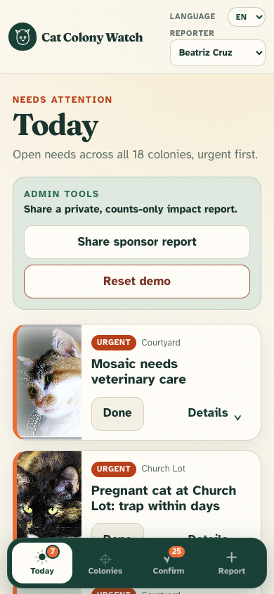
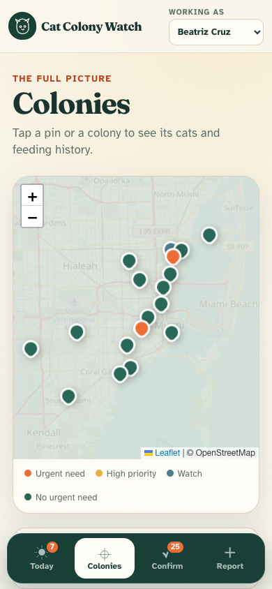
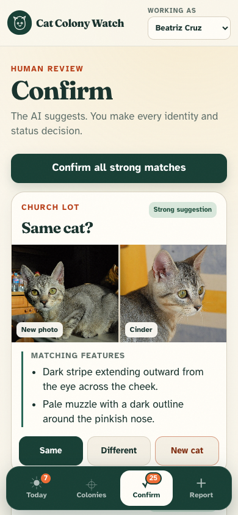
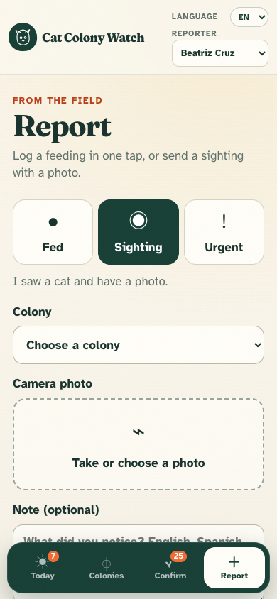

# Cat Colony Watch

**[Open the live app](https://cat-colony-watch.onrender.com)**

Cat Colony Watch turns a street cat rescue's scattered messages, photos and locations into one current record of every colony and cat. Volunteers can report a feeding in one tap. Beatriz can see urgent needs first, check who fed each colony, review possible photo matches, and share a private counts-only report with a sponsor.

The demo is for Mangrove Mews, a made-up Miami rescue caring for 18 colonies. Its people, messages, phone numbers and approximate locations are invented. Its cat photos are openly licensed Wikimedia Commons images—not private rescue photos.

> The AI reads the report and suggests what it found. A person confirms every cat merge and every adopted, missing or deceased status change.

## For Beatriz and the rescue team

### Start here

1. Open the [live app](https://cat-colony-watch.onrender.com) on a phone or laptop. A free Render service may take up to a minute to wake up.
2. Enter the team passcode Beatriz shared with you. Do not post this passcode publicly.
3. Choose your name under **Reporter**. The app remembers it on that phone.
4. Use the language menu to choose English, Español or Kreyòl. The choice carries across sign-in, the app and sponsor reports.
5. Use the four tabs at the bottom:
   - **Today** puts urgent needs first. Tap **Done** after the team handles one.
   - **Colonies** shows all 18 colonies on a map and in a list. Tap a colony for its cat count, fixed count, TNR list, vet needs, latest feeding, feeders and cat profiles.
   - **Confirm** puts two photos side by side. Read the matching and differing markings, then choose **Same**, **Different** or **New cat**. Strong suggestions can be confirmed together, but the app never merges cats by itself.
   - **Report** logs a feeding, sighting or urgent need. A sighting can include a camera photo, a short note and the phone's location. The app immediately says what it recorded.

Admins see **Share sponsor report** at the top of Today. Enter the separate admin passcode to reveal a secret link, then tap **Copy link**. Anyone with that link can see aggregate impact counts, but never locations, volunteer names, phone numbers or photos. Treat it like a private document link.

Admins also see **Reset demo**. It requires the admin passcode and removes every live report, decision and uploaded photo before rebuilding the original demo. It does not reset API spend already incurred that day. Photo reports show their own estimated API cost, and the server retains that cost history across resets and redeploys. The live app does not enforce a daily spend cap, so the OpenAI project should have an account-level budget and usage alerts.

### What is real and what is still a demo

The reporting, matching suggestions, human decisions, alerts, persistence and privacy boundary are working application paths. The rescue, volunteers, locations, chat history and starting cat census are deliberately fictional. This version uses a shared team passcode rather than individual user accounts, and importing a private historical chat remains a developer-assisted command. Before use by a real rescue, replace the demo seed with its approved private data, set new secrets, configure a rescue-owned Upstash database and OpenAI project, and define who is allowed to use the admin passcode.

### Bringing in a WhatsApp history

Cat Colony Watch does not connect to or automate WhatsApp. It only reads a chat export that a person deliberately saves.

On an iPhone, open the group, tap the group name, choose **Export Chat**, include media, and save the ZIP to Files. Keep real exports and private photos out of this repository. The current prototype's historical import is a developer-assisted command rather than an upload screen:

1. Unzip the export into a private folder. It should contain `_chat.txt` and its attached photos.
2. Add the rescue's private `colonies.json` and `volunteers.json` setup files to that folder.
3. On a trusted computer with the app configured, run:

   ```bash
   python -m app.import_demo \
     --data-dir /path/to/private-export \
     --db /tmp/cat-colony-watch-import.db \
     --max-spend 3
   ```

The public demo follows the same pipeline using only invented data in `data/demo/`. New day-to-day updates should use the Report tab.

## Screenshots

<table>
  <tr>
    <td align="center"><br><strong>Urgent work first</strong></td>
    <td align="center"><br><strong>All 18 colonies</strong></td>
    <td align="center"><br><strong>Human-confirmed matches</strong></td>
    <td align="center"><br><strong>Under-a-minute reports</strong></td>
  </tr>
</table>

## Deploy your own copy

[](https://render.com/deploy?repo=https://github.com/jdanzig/cat-colony-watch)

1. Create a free [Upstash Redis](https://upstash.com/) database. In its REST API section, copy the REST URL and REST token.
2. Click **Deploy to Render**, connect the repository, and let Render read `render.yaml`.
3. Fill in the secret environment values when Render asks:
   - `OPENAI_API_KEY`: an OpenAI API key with a spending limit.
   - `TEAM_PASSCODE`: the passcode volunteers use to enter the app.
   - `ADMIN_PASSCODE`: a different, longer passcode for admin actions.
   - `UPSTASH_REDIS_REST_URL` and `UPSTASH_REDIS_REST_TOKEN`: the values from Upstash.
   - `SPONSOR_REPORT_TOKEN`: optional; use a long random value, or leave it blank so the app derives a stable token from the admin passcode.
4. Keep the default vision-capable `OPENAI_MODEL`, or set another compatible model.
5. Deploy, then open `/healthz`. A ready deployment returns `{"ok": true, "ready": true}`.
6. Share the app URL and team passcode privately with volunteers. Keep the admin passcode separate.

Render runs the FastAPI service from the Blueprint. SQLite is rebuilt from the committed demo on startup, then the append-only Upstash change log replays live reports and human decisions. That is how reports survive a restart or redeploy. Without the two Upstash variables, local development uses a local JSON change log instead.

Use the [operations guide](docs/OPERATIONS.md) for release checks, private backup and restore, monitoring, incidents, privacy retention and the remaining real-world launch gates.

## Developer guide

### Stack

- Python 3.11+, FastAPI and stdlib `sqlite3`
- One static HTML/CSS/JavaScript page; no frontend build step
- OpenAI API vision and the OpenAI Agents SDK
- Pillow for resizing and cat crops; Leaflet and OpenStreetMap for the map
- Upstash Redis REST for the durable change log on Render

The main flow is:

```text
WhatsApp export or phone report
  -> parse message, photo and location
  -> describe visible cat features
  -> structured app fields or the Agents SDK importer record events
  -> fixed matching rule creates a suggestion
  -> human confirms any merge or status change
  -> SQLite views and fixed alert rules update the UI
```

Photo descriptions and comparisons are cached by input hash in `ai_cache.json`. Images are resized to about 768 px before an API call, and every call logs its token use and estimated cost. The committed demo can rebuild entirely from its cache without spending API credits.

### Run locally

```bash
python -m venv .venv
source .venv/bin/activate
pip install -r requirements.txt
cp .env.example .env
# Add OPENAI_API_KEY, TEAM_PASSCODE and ADMIN_PASSCODE to .env
uvicorn app.main:app --reload
```

Then open <http://127.0.0.1:8000>. For local-only work, the Upstash values may remain blank.

### Tests

The small assertion-based checks cover the chat parser, photo-matching decision rule, database counting rule, alerts, recorded human decisions, replay persistence, demo import and authenticated web routes:

```bash
for test_file in \
  tests/test_parser.py \
  tests/test_identification.py \
  tests/test_database.py \
  tests/test_rules.py \
  tests/test_change_log.py \
  tests/test_import_demo.py \
  tests/test_web.py
do
  python "$test_file"
done
```

Run the cat-identification evaluation separately after changing its prompts or matching rule:

```bash
python eval/check_matching.py --cats 15 --seed 2 --hard-colony
```

See [EVAL.md](EVAL.md) for the protocol and [eval/results/REPORT.md](eval/results/REPORT.md) for recorded runs.

Create a private backup of live changes and uploaded photos with `python -m app.backup --export /private/path/backup.json`. Restore is intentionally explicit; see the [operations guide](docs/OPERATIONS.md).

## How we built it

Cat Colony Watch was built with **Codex**, using the OpenAI API for structured vision observations and the **OpenAI Agents SDK** to turn English and Spanish field reports into explicit tool calls. The safety boundary is deliberately outside the model: the model reads specific features, tested Python rules decide suggestion strength and alerts, and people make identity and status decisions.

The final no-tuning validation put 15 cats—including black-cat and red-tabby look-alikes—into one hard colony and tested 94 query photos:

- Strong-match precision: **100% (14/14)**; wrong-strong rate: **0% (0/94)**.
- False-split rate: **4.1% (3/74)**; new-cat recall: **80% (16/20)**.
- Held-out strong precision: **100% (14/14)**; held-out wrong-strong rate: **0% (0/87)**.
- Held-out false-split rate: **4.3% (3/69)**; held-out new-cat recall: **83.3% (15/18)**.
- Run cost: **$0.7524**, or about **$0.80 per 100 query photos**.

Strong suggestions were intentionally conservative: 14.9% of all queries were strong and 64.9% were weak enough to ask a person. Full results and the difficult cases are in [the matching report](eval/results/REPORT.md). The committed demo's complete cached AI build cost is $0.730874 and rebuilding it costs $0.

## Photo credits and privacy

Every demo photo's author, license and Wikimedia Commons source page is listed in [data/demo/PHOTO_SOURCES.md](data/demo/PHOTO_SOURCES.md). The demo contains no private photos, real chat exports, real addresses or real phone numbers.

Every app page and API route requires the team passcode except `/healthz`, the sign-in page and the unguessable sponsor-report link. The sponsor report returns aggregate counts only.

## License

[MIT](LICENSE)
